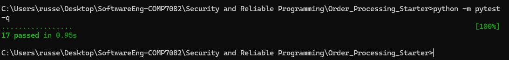

"# Security-and-Reliable-Programming" 

Defects:

1) In the database there is nothing blocking stock levels to go negative. to fix this a check was added to the table to reject any negative stock levels. 

2) list_orders does not filter by the user when quiering the database leaking order information, the missing "WHERE user_id = ?" was added. 

3) get_product ises f strings when it should be using parameterized queries to prevent SQL injection, to fix this it was changed to a parameterized query.

4) the same issue as number 3 exists for get_saved_cart making it vulnrable to SQL attacks, to fix this a parameterized query was added in place of the f string. 

5) in checkout.py, when payment is processed a print statement prints the payment token to the console, this is a security risk as it exposes sensitive information about the client and so should not be logged. to fix this the print statement was edited so checkout.py just says that it was charged but does not reveal the token.

6) in cart.py, the cupon code SAVE15 reduces the price by 15 dollars, this means on a small order the total order price could be negative, to fix this the max or the order or 0 is selected.

7) in checkout.py, as noted by the comment stock was updated before the client was charged so if the payment failed stock would still be reduced causing a mismatch, to fix this stock is now updated only if the payment is a sucsess.

8) in cart.py when load() is called items stored in the database are added to the cart however if it is called again the items will be added again duplicating them in the cart, to fix this when load is called the cart is first emptied then loaded from the database to ensure the correct quantity. 

Tests:

See test_smoke for tests, they report:

